<p align="center">
  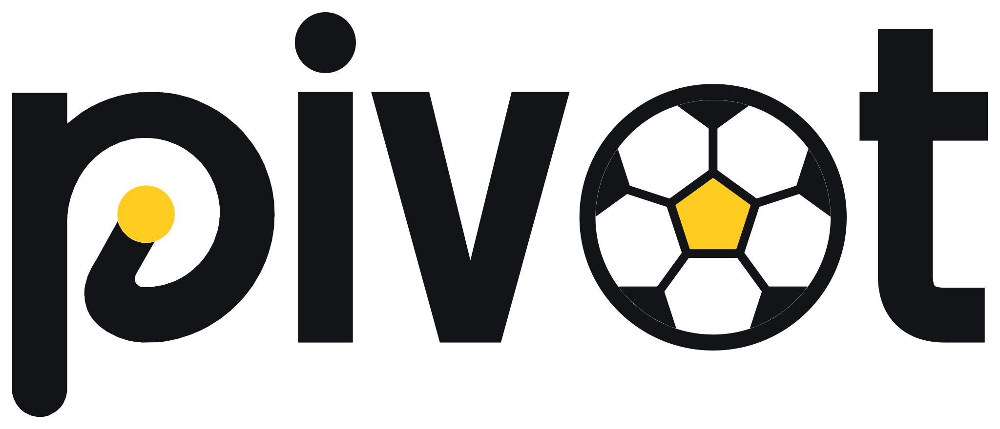
</p>

<h3 align="center">The moments that changed the match, and why.</h3>

<p align="center">
Pivot finds the few moments that turned a football match, has AI agents explain why each one mattered, checks every number they use, and lets you replay the rest of the match with one decision changed: as a fan or as an analyst, for your club and your player, in English, Chinese or Spanish.
</p>

<p align="center">
  <a href="https://pivot.in-stacks.com"></a>
  <a href="https://youtu.be/HGJ11chiHKg"></a>
  
  
  
  
</p>

<p align="center">
  <b><a href="https://pivot.in-stacks.com">Open the live demo</a></b> (no sign-in) ·
  <b><a href="https://youtu.be/HGJ11chiHKg">▶ Watch the demo video</a></b> (1:55) ·
  <a href="docs/submission/project-description.md">Project description</a> ·
  <a href="#how-it-works">How it works</a> ·
  <a href="#run-it-locally">Run it locally</a>
</p>

<p align="center">
  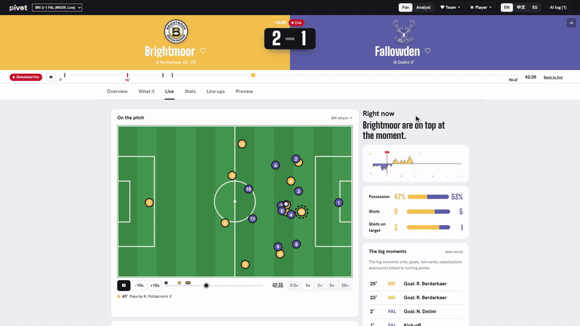
  <br><sub>A simulated live match. The same minute in <b>Fan</b> view, then one click to <b>Analyst</b> view.</sub>
</p>

## Pivot in 30 seconds

- **The problem.** Match stats tell you *what* happened: possession, shots, xG. They don't tell you which moments turned the game, or why. AI can write a fluent summary, but it gets numbers wrong, and one wrong number loses a fan's trust.
- **What Pivot does.** It follows the match minute by minute, flags the minutes where the game swung, and has a team of AI agents explain each one. A Verifier, written as plain code, recomputes every number before it reaches the screen. Then you can ask *"what if?"*: Pivot saves the match at that minute and replays the rest 200 times each way.
- **Who it is for.** A fan gets the story in plain words, from their club's side, around the player they follow. An analyst gets a live data centre and a post-match report. These are two different pages, not one page with different wording.

## One pipeline, five stages

The challenge (rule 4.1) asks for one pipeline: ingest, interpret, explain, render, personalize. This is how Pivot does each step.

| Stage | What Pivot does | Where to see it |
|---|---|---|
| **Ingest** | Our own match engine plays 22 rated players, each with a position every second. It sends out every event: passes, shots, tackles, pressure and possession changes. Every match can be replayed from its seed and saved at any minute. | **Live** tab of the simulated live match |
| **Interpret** | It computes 23 team stats for the whole match, either half or any window of minutes, including xG, field tilt and PPDA. A per-minute momentum meter and a change-point alarm flag the minutes where the game swung. | **Overview**, **Stats** |
| **Explain** | Agents built with Microsoft Agent Framework on Azure AI Foundry:<br>• a **Judge** decides whether a moment is a real turning point;<br>• an **Explainer** writes why;<br>• a **Verifier** recomputes every number and sends wrong drafts back. | Turning-point cards, **AI log** |
| **Render** | A momentum chart, turning-point cards, and a pitch that draws passes, shots and tackles as they happen, with shape lines, pressing zones and passing lanes. Every key moment and set piece has a clip. | **Live**, **Replay**, **Overview** |
| **Personalize** | **Fan** or **Analyst** view. Pick your club, and the moment is told from your side. Follow a player, and that player stays highlighted all match. English, Chinese or Spanish, each version checked again. | Top bar: **Fan / Analyst**, **♥ Team**, **★ Player**, **EN / 中文 / ES** |

## See it

| Fan view, live | Analyst view, live |
|---|---|
| 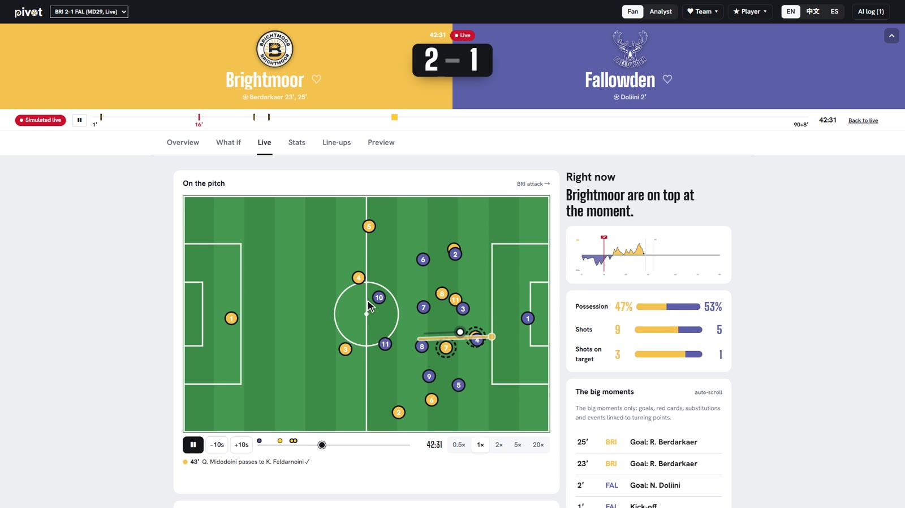 | 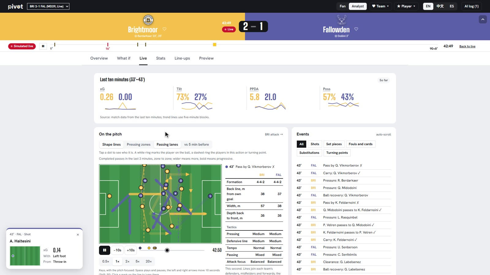 |
| **A turning point, every number checked.** Hover a number to see the statistic it was checked against. | **The AI log.** The Verifier sent the first draft back with its reasons, and the Explainer rewrote it. |
| 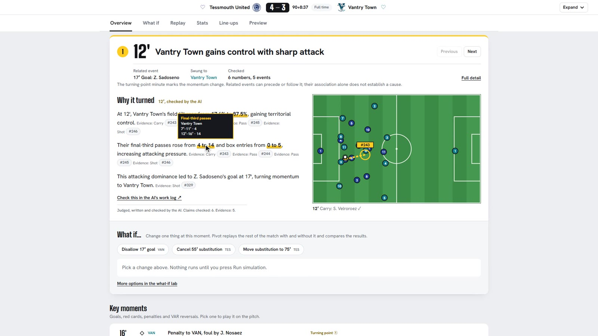 | 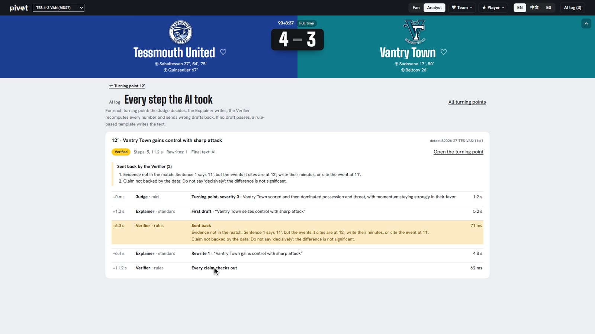 |
| **What if, for a fan.** The biggest what-ifs of the match, for your team, in one line. | **What if, for an analyst.** The effect with 95% ranges, and "clear difference" only when the ranges don't overlap. |
| 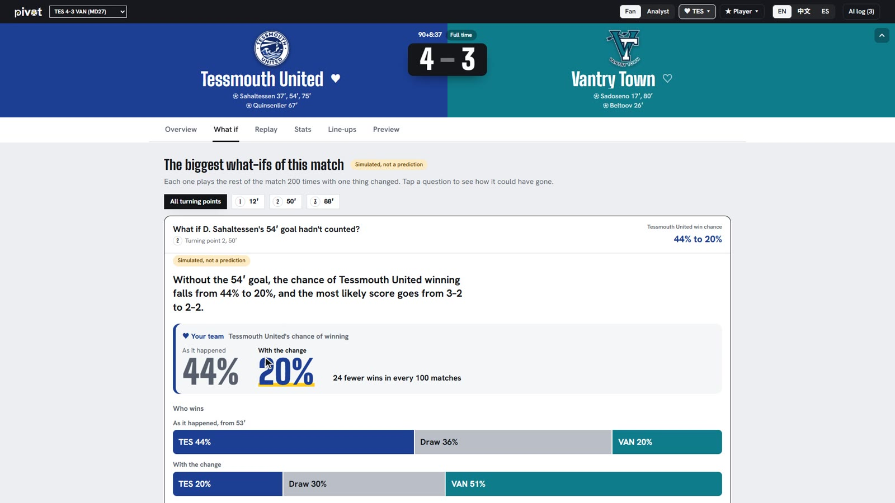 | 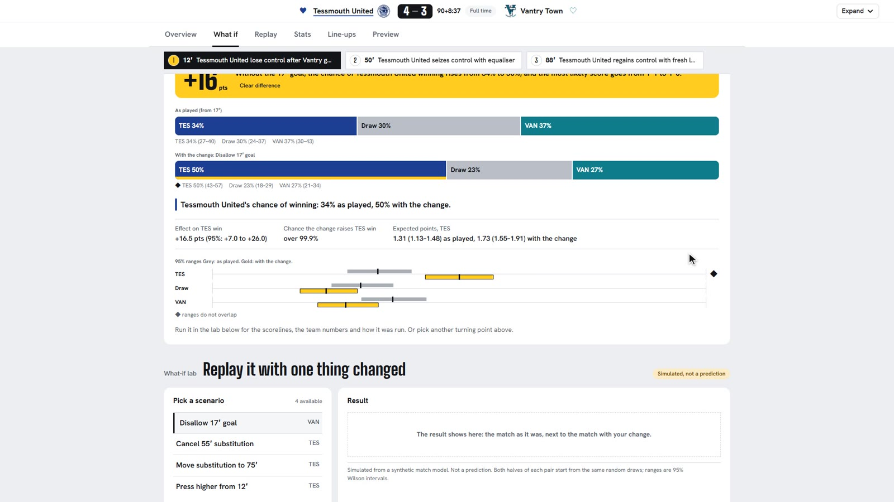 |
| **Your club, your language.** The same checked moment from Tessmouth's side, here in Chinese. | **Analyst report.** Match phases, game state, shot quality, attacking lanes and style percentiles. |
| 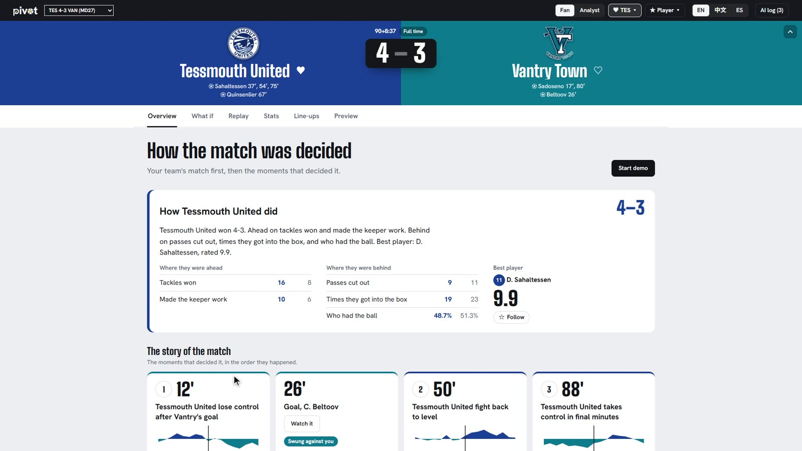 | 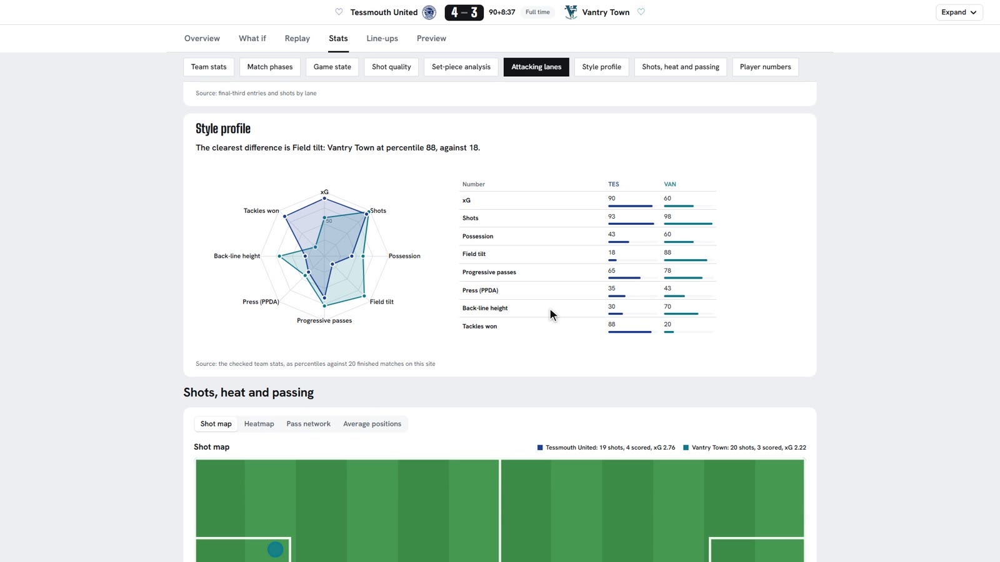 |

## Why it stands out

| Judging criterion | What to look at |
|---|---|
| **Agentic design and innovation** | Judge → Explainer ⇄ Verifier is a Microsoft Agent Framework workflow with a rewrite loop. A failed draft goes back with the problems listed. After three failures, a plain summary built only from checked numbers is shown and marked "Auto summary". A Comparator agent explains each what-if. Every step, with model, latency and verdict, is in the **AI log**. |
| **Technological implementation** | A reproducible simulator that can be saved at any minute. What-if replays use paired seeds: run *i* with and without the change uses the same random seed, so the change is the only difference within a pair. Results come with 95% Wilson ranges. They are stored in Azure Cosmos DB, so a repeated question never calls the model again. |
| **Real-world impact** | Fans get a story they can trust. Analysts can test "did that decision really decide it?" with a controlled replay instead of an opinion. Everything after the simulator reads a plain list of events, so one adapter would bring in a real event feed (see [From synthetic matches to real ones](#from-synthetic-matches-to-real-ones)). |
| **User experience** | Fan and Analyst are two different pages on every tab, the followed player is highlighted across the match, there are three languages, and the live site needs no sign-in. |
| **Hackathon category** | All five stages of rule 4.1 above, on synthetic, football-realistic data. |

## Try it

**Live demo: https://pivot.in-stacks.com/**

No sign-in is needed. The site has 20 simulated matches, real fixtures of the simulated season played in full, and opens **Tessmouth United 4–3 Vantry Town** (`?match=S2026-27-TES-VAN`); the others are in the match menu in the top bar. Every match is an ordinary simulation: nothing in it is staged. A private window works best, because the site remembers your language, viewer settings and last match.

The match page has six tabs: **Overview, What if, Replay, Stats, Line-ups, Preview**. Each tab has its own link (`?tab=overview|whatif|replay|stats|lineups|preview`); old links with `?tab=pre|live|post` still open Preview, Replay and Overview.

| Step | Do this | You should see |
|---|---|---|
| 1 | Open the link | **Overview**: the score band (it folds into a slim bar as you scroll), "The 3 moments that changed the course of this match" and a momentum chart marked ① 12′ ② 50′ ③ 88′. |
| 2 | Look at **① 12′ "Vantry Town gains control with sharp attack"**, open under the list | What set it off (17′ goal, Z. Sadoseno), which way momentum went, "Verified ✓", and the **Why it turned** sentences. Hover an underlined number to see the statistic it was checked against. Click an evidence chip such as **#329** to see the event on the mini pitch. |
| 3 | In the top bar, switch **Analyst → Fan** and pick **♥ Tessmouth United**, then click **① 12′** | The same moment, rewritten from Tessmouth's side: "Tessmouth United lose control after Vantry's goal". The analyst version shows for a few seconds if a version is still being written. |
| 4 | Click **中文** and **ES**, then **EN** | The explanation in Chinese and Spanish. Every version goes through the same checks, so the evidence chips stay. |
| 5 | Pick **★ D. Sahaltessen** (three goals), then open **Stats** | His player card: rating 9.9, goals, shots, heatmap and his part in each turning point. Further down are the 23 team stats (whole match or either half), a shot map, heatmaps and a pass network. |
| 6 | Open the **What if** tab. Under **Turning point 1, 12′**, pick **Disallow 17′ goal**, keep **200** runs, click **Run simulation** | "Instant: simulated before". Without the 17′ goal, Tessmouth's chance of winning rises from 34% to 50%, and the most likely score goes from 1–1 to 1–0. The panel also shows 95% ranges and "Why it differs". |
| 7 | Under **Key moments**, click a goal; under **Set pieces & shots**, click the **7′ free kick** | A short clip on the pitch at 0.25× to 5×. For the set piece it also shows how many attackers and defenders were in the box and how they were marked. |
| 8 | Open **Replay** and click **Start demo** | The match replays from 0′. Players glide on the pitch, passes, shots, tackles and cards are drawn as they happen, momentum is drawn live, and each turning point appears at its minute. Add `&from=75` to the link to start at 75:00 on the replay clock, just before the 75′ goal. |
| 9 | Open **Preview** and **Line-ups** | Form, the last five games, home and away records, what comes next, both line-ups and each coach's plan (formation, style, press, tempo, set pieces). |
| 10 | Pick another match in the top bar | Steps 1 to 9 work the same on every match. |

The live server has only 2 CPU cores. The what-if chips on the demo match were computed in advance, so a stored one, such as **Disallow 17′ goal**, answers at once. A scenario that is not stored takes a few minutes there and queues behind the others. Every scenario runs quickly on your own machine (see [Run it locally](#run-it-locally)).

To see what the AI agents did, click **AI log** in the top bar. It lists each step (Judge, Explainer, Verifier) for every turning point, the model used, latency, tokens and the verdict. The raw data is at `https://pivot.in-stacks.com/api/pivots/<pivot id>/traces`. The pivot id (such as `S2026-27-TES-VAN:p11`) is in the link once a turning point is open (`&pivot=`).

## How it works

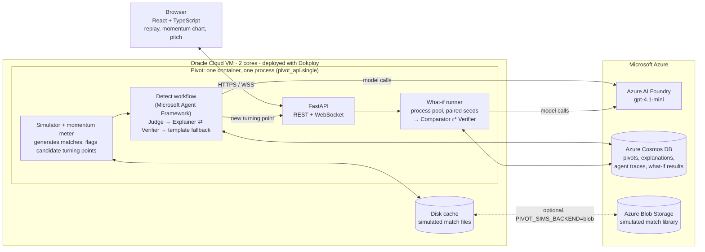

1. **Simulator.** A possession-chain engine plays a full match with 22 rated players: events (passes, shots with xG, fouls, cards, substitutions, VAR) plus player positions every second. Each match is reproducible from its seed and can be saved at any minute and played on.
2. **Momentum meter.** Per-minute momentum is built the way Opta builds the Premier League's match momentum: each team's most dangerous moment of the minute (the threat value of where an action starts or successfully ends, capped at 0.1), weighted towards the last 3–4 minutes (1.5-minute half-life), home minus away. A two-sided CUSUM change-point alarm flags the minutes where it swings and stays swung. These are *candidates*: about 2.5 per simulated match, and 1.4 per real match when run on the 64 matches of the 2022 World Cup (StatsBomb open data).
3. **Detect workflow** (Microsoft Agent Framework `WorkflowBuilder`):
   - **Judge** (LLM) decides whether a candidate really is a turning point and how severe it is.
   - **Explainer** (LLM) writes a headline and up to three sentences. Each sentence cites event ids, and each number cites a stat reference.
   - **Verifier** (deterministic code) recomputes every cited number from the events and checks the score, which side momentum went to, and that every cited event was actually offered. If a check fails, the draft goes back to the Explainer with the problems listed. After three failed checks, or on a model error or timeout, a **template explainer** writes a plain, correct card instead (shown as "Auto summary").
4. **What-if Lab.** The match is saved at the turning-point minute and played on N times as it was and N times with the change. Run *i* of both groups uses the same random seed, so the only difference between the pair is the change. Results are win/draw/loss shares with Wilson 95% intervals. The **Comparator** (LLM) writes "Why it differs". The Verifier only allows "more likely"-style words that match the computed change, and only allows "clear difference" when the intervals do not overlap.
5. **Personalisation.** Analyst or Fan wording, a focus team or player, and English / Chinese / Spanish. Every version goes through the same Verifier.

Design decisions are recorded in [docs/adr/](docs/adr/). The full architecture, including how the original all-Azure plan maps to what is deployed, is in [docs/architecture.md](docs/architecture.md) (Chinese).

## Microsoft technology

| Technology | What Pivot uses it for |
|---|---|
| **Azure AI Foundry** (gpt-4.1-mini) | The Judge, Explainer and Comparator agents. Calls have per-attempt timeouts and a shared deadline, so a slow model degrades to the template instead of breaking the page. |
| **Microsoft Agent Framework** | The detect pipeline is an Agent Framework workflow: `Executor` nodes for Judge, Explainer, Verifier and Template, with the rewrite loop and fallbacks as edges ([`apps/worker/src/pivot_worker/detect.py`](apps/worker/src/pivot_worker/detect.py)). |
| **Azure Cosmos DB** (free tier) | Stores everything the AI produced: turning-point verdicts, explanations per language and audience, agent traces, and what-if results. A restart reads them back instead of calling the model again, and a repeated what-if question answers instantly. If Cosmos DB is unreachable, results go to local files. |
| **Azure Blob Storage** | The library of simulated match files (events plus per-second tracking, about 1 MB each compressed). Blob is the source of truth and the disk is a cache. Matches can be generated on a laptop and uploaded with [`scripts/sims_blob.py`](scripts/sims_blob.py). |
| **Microsoft Entra ID** | The server signs in to Foundry, Cosmos DB and Blob with a service principal and role assignments. No account keys are stored anywhere. |
| **GitHub** (Actions, Projects) | CI on every pull request: lint, Python tests, a check that the generated contracts are up to date, and a secret scan. All work was planned as issues on a GitHub Projects board. |

## Why you can trust the numbers

Language models are good at telling a story and bad at arithmetic. Pivot keeps the two jobs apart:

- **The model never computes a number that reaches the screen unchecked.** Each number in an explanation carries a stat reference (for example "home shots, minutes 30–39"). The Verifier recomputes it from the event log and rejects the draft if it does not match within tolerance.
- **Every sentence cites evidence.** Event ids link each sentence to real events in the match, so you can click and see them on the pitch.
- **Facts are checked too, not only numbers.** The Verifier checks the score at each minute, which side momentum went to, that cited events and player context belong to the moment, red-card counts ("ten men" only when it fits), and that "more/less likely" in what-if text matches the computed change.
- **There is always a correct fallback.** If no draft passes after three tries, or the model is slow or down, a template explanation built only from verified stats is shown and marked "Auto summary". The page never shows an error instead of an answer.
- **What-if results are reproducible.** The same scenario gives the same numbers on any machine (fixed seeds, paired runs). They are labelled "Simulated, not a prediction".

## How realistic is the simulator?

Pivot explains synthetic matches, so the simulator has to play like real football. [`scripts/realism_scorecard.py`](scripts/realism_scorecard.py) compares simulated matches with real Premier League numbers ([`eval/realism/reference.json`](eval/realism/reference.json)): the 2023/24 and 2024/25 seasons (760 matches, football-data.co.uk) and StatsBomb open data for 2015/16 (380 matches) for event-level stats.

Below is a run of 60 simulated matches with the demo pairing (`uv run scripts/realism_scorecard.py --matches 60 --red 30`, run 10/25). **29 of 44 checks are within tolerance.** A selection, including misses:

| Per match | Simulated | Premier League | Source | Within tolerance |
|---|---|---|---|---|
| Goals | 2.9 | 3.1 | 2023–25 | ✓ |
| Goals in the first half | 44.8% | 43.8% | 2023–25 | ✓ |
| Shots | 25.4 | 26.8 | 2023–25 | ✓ |
| Shots on target | 9.6 | 9.5 | 2023–25 | ✓ |
| Fouls | 22.9 | 22.1 | 2023–25 | ✓ |
| Yellow cards | 3.7 | 4.1 | 2023–25 | ✓ |
| Passes (no throw-ins) | 825 | 924 | 2015/16 | ✓ |
| Pass height: ground / low / high | 66 / 11 / 23% | 64 / 13 / 23% | 2015/16 | ✓ |
| Pressures | 274 | 304 | 2015/16 | ✓ |
| Home / draw / away | 40 / 30 / 30% | 43 / 23 / 34% | 2023–25 | (60 matches) |
| Pass accuracy | 70.8% | 76.0% | 2015/16 | ✗ |
| Interceptions | 13.4 | 23.5 | 2015/16 | ✗ |
| Clearances | 26.4 | 57.0 | 2015/16 | ✗ |
| xG per shot | 0.127 | 0.105–0.125 | literature | ✗ |

Effects matter as much as averages, because Pivot explains *changes*. With an away red card at 38′ (30 paired seeds), the 11-man side's share of shots rises from 0.61 to 0.77; in Premier League 2015/16 matches with a red card it was 0.72. The leading side's back line drops late in the game (−1.8 m against a real range of −1 to −8 m) and the trailing side's moves up (+2.2 m against +1 to +8 m). The simulator rules behind these numbers are in [docs/sim-realism.md](docs/sim-realism.md) (Chinese).

## From synthetic matches to real ones

The hackathon rules require synthetic data, so every match here comes from the simulator, streamed minute by minute as if it were live. The momentum meter, the alarm, the AI agents, the Verifier and the What-if Lab all run on that live stream.

Everything after the simulator reads one thing: a list of match events (`MatchEvent`: time, team, player, location, type, outcome). Connecting a real match means writing an adapter that turns a data provider's feed into these events. That adapter does not exist yet; the rest of the pipeline would stay as it is. The simulator stays too: What-if replays would start from the real match state at that minute.

| Source | What it gives | Live? | Notes |
| --- | --- | --- | --- |
| StatsBomb open data | Full event data for past matches, some with player positions | No | Free. The first step: check whether the turning points Pivot finds in real matches are the ones analysts would pick, and learn a real expected-threat grid to replace the distance-based placeholder |
| Commercial event feeds (e.g. Stats Perform/Opta, Sportradar, StatsBomb) | Every pass, shot and foul, seconds after it happens | Yes | Licensed per competition and use |
| Optical tracking data | 10–25 position frames per second for all players and the ball | Yes | Usually sold to clubs and broadcasters |
| Broadcast video | Everything, in principle | Yes | Hard computer vision, and it needs the rights holder's permission. Not something we would do without a licence |

Where it could go next:

- **Broadcasters and streaming platforms**: a feed of turning points with checked explanations, shown beside the live picture, with a "What if" for viewers. The read-only API and the broadcast overlay page already exist.
- **Clubs and analysts**: post-match review of turning points, team shape and set pieces.
- **A fan app**: turning points and explanations for everyone, What-if replays and share cards on top, once data licensing costs are clear.

## Run it locally

You need [uv](https://docs.astral.sh/uv/) (Python 3.12) and [pnpm](https://pnpm.io/) (Node 20.19+). `PIVOT_PIPELINE=fake` uses the template explainer instead of Azure, so **no keys or Azure account are needed**.

```bash
uv sync && pnpm install && pnpm --filter web build
```

```bash
PIVOT_PIPELINE=fake PIVOT_SIM_MATCHES=1 PIVOT_WHATIF_WARM=0 PIVOT_DATA_DIR=.pivot-data uv run python -m pivot_api.single
```

Open http://127.0.0.1:8000/. It opens the first simulated match (`PIVOT_SIM_MATCHES=1` makes just one, `S2026-27-TES-VAN`, in a few seconds). The site, API, WebSocket, simulator, agents and what-if runner all run in this one process. Explanations are template text in this mode, which is expected. A 200-run what-if takes about 30 seconds on a laptop. Add `PORT=8011` in front to use another port.

Checks and tests:

```bash
uv run ruff check . && uv run pytest
```

```bash
pnpm --filter web test
```

To use real models, set `PIVOT_PIPELINE=detect`, `PIVOT_FOUNDRY_ENDPOINT`, `PIVOT_MODEL_STANDARD` and `PIVOT_MODEL_MINI`, and sign in with `az login` (an identity with the "Cognitive Services OpenAI User" role). All settings for the deployed server are listed in [deploy/oracle/.env.example](deploy/oracle/.env.example), and deployment is described in [docs/deploy-oracle.md](docs/deploy-oracle.md). A `Dockerfile` builds the same single-process image (`docker build -t pivot . && docker run --rm -p 8000:8000 pivot`).

Developer notes in Chinese: [docs/dev-setup.zh.md](docs/dev-setup.zh.md). Contribution rules: [CONTRIBUTING.md](CONTRIBUTING.md).

## Repository layout

| Path | What is in it |
|---|---|
| [`apps/api`](apps/api) | FastAPI app: REST, WebSocket, what-if endpoints; `pivot_api.single` runs everything in one process |
| [`apps/worker`](apps/worker) | The agents: Judge, Explainer, Verifier, Comparator, templates, the Agent Framework workflow |
| [`apps/web`](apps/web) | React + TypeScript + Vite front end: live board, turning-point detail, What-if Lab, broadcast overlay |
| [`apps/simulator`](apps/simulator) | Command-line entry point for the simulator |
| [`packages/pivot_core`](packages/pivot_core) | Domain models (the shared contract), simulator, momentum, change-point detection, what-if runner |
| [`packages/pivot_adapters`](packages/pivot_adapters) | Storage adapters: local files, Azure Cosmos DB, Azure Blob Storage |
| [`packages/contracts`](packages/contracts) | JSON Schema and TypeScript types generated from the domain models |
| [`eval/`](eval) | The demo match fixture and the real-football reference numbers |
| [`scripts/`](scripts) | Realism scorecard, demo/season generators, Blob upload, Foundry quota test, project tooling |
| [`deploy/oracle`](deploy/oracle) | Deployment settings for the Oracle VM (Dokploy) |
| [`docs/`](docs) | Architecture, ADRs, data definitions, test checklist, screenshots |

## Data and disclaimer

Every match, club, coach, player and referee in Pivot is **synthetic**, generated by the simulator from a seed. There are no real clubs, real players, Premier League marks or broadcast footage. Real football data is used only as summary numbers to calibrate the simulator (above), and the raw files are not in this repository. What-if results come from a simulation of a synthetic match. They are not predictions about real football.

## Next steps

What we knowingly left for after the deadline:

- **Pitch overlays on the analyst Live tab**: the team's shape lines, pressing zones and passing lanes drawn on the live pitch.
- **Next-round predictions that use the pre-match context.** Context effects (form, news, reunions) are off by default, so every simulation, the next-round predictions included, ignores them for now.
- **What-if precompute for the other 18 matches.** What-if is precomputed for the demo and the live match; the other 18 matches compute on the server on first use (slower). Precompute them later.
- **The mobile layout** ([#259](https://github.com/neubayarea/Pivot/issues/259): on a phone the English and Spanish match header is too long, and the page scrolls sideways).
- [#338](https://github.com/neubayarea/Pivot/issues/338): the single-process local build on Windows answers an unknown API path with the home page instead of a 404.
- [#342](https://github.com/neubayarea/Pivot/issues/342): the synthetic season's schedule gives some clubs many more away games than home games.

## Team

| Line | Area | GitHub |
|---|---|---|
| A | Platform: API, real-time, deployment, Azure | [@Carry3](https://github.com/Carry3) |
| B | Simulator, momentum and turning-point detection | [@momomojun](https://github.com/momomojun) |
| C | Web front end | [@Avril131](https://github.com/Avril131) |
| D | AI agents and verification | [@JadenChen10](https://github.com/JadenChen10) |

## How we used AI tools

- **Claude Code** (Anthropic) was the main coding assistant. Team members worked with it on issues from the project board, one issue per branch and pull request, and reviewed and merged the results. Commits it helped write carry a `Co-Authored-By: Claude` line, which is the case for most commits in this repository. The rules agents follow in this repo are in [AGENTS.md](AGENTS.md).
- **Inside the product**, the language model only writes words. Detection is done by the momentum meter and change-point alarm, numbers are computed by code, and the Verifier checks every draft (see [Why you can trust the numbers](#why-you-can-trust-the-numbers)).

## License

[MIT](LICENSE). The match data is synthetic; see [Data and disclaimer](#data-and-disclaimer).
