# Pivot 架构设计

> 版本 v1.1 · 2026-10-25 · 状态：已上线（https://pivot.in-stacks.com）· 适用范围：黑客松交付（10/26 提交）
> 上游文档：Pivot PRD v1.0 · 决策记录：[`docs/adr/`](adr/)
>
> **先看下面「实际上线的样子」这一节。** 第 2 节以后的 C4 图和部署形态是 10/23 定的原计划（全部跑在 Azure 上），实际交付做了取舍，对照表写在那一节里。

## 实际上线的样子（10/25 更新）

### 一句话

网站只有**一个程序**，跑在**甲骨文云的一台服务器**上；AI 用 **Azure AI Foundry** 的模型，AI 写的东西存在 **Azure Cosmos DB**；模拟出来的比赛文件存在服务器的硬盘上。

### 架构图

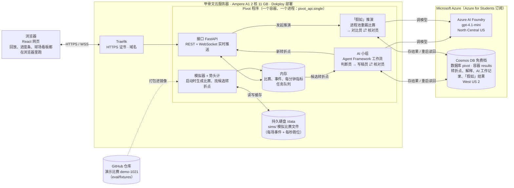

服务器登录 Azure 用的是一个服务主体（`AZURE_TENANT_ID`、`AZURE_CLIENT_ID`、`AZURE_CLIENT_SECRET`，只填在 Dokploy 的设置里），Foundry 和 Cosmos DB 都用它，不用账号密钥。所有设置项见 [`deploy/oracle/.env.example`](../deploy/oracle/.env.example)。

### 每样数据存在哪

| 数据 | 存在哪 | 重启后 | 说明 |
|---|---|---|---|
| 演示比赛 demo-1021（事件、指标、每秒跑位） | GitHub 仓库 `eval/fixtures/`，打包进镜像 | 一直在 | 录 Demo 用的固定比赛，唯一提交进仓库的比赛数据 |
| 其他模拟比赛（6 场，每场事件 + 每秒跑位） | 服务器硬盘 `/data/sims/`（Dokploy 持久卷 `pivot-data`） | 直接读回；改了模拟器代码会自动重新生成 | 不进 GitHub，见 [比赛数据放在哪](match-data.md) |
| 比赛、事件、每分钟指标（运行中） | 程序内存 | 启动时从上面两处重新载入 | |
| AI 写的东西：转折点判断、解释（各语言、各观众版本）、AI 工作记录 | **Azure Cosmos DB**（`PIVOT_RESULTS_BACKEND=cosmos`） | 直接读回，不再调模型 | Cosmos 连不上时自动改存硬盘 `/data/results/`；模型当时没调通、退回模板的结果不存，下次重试 |
| 「假如」推演结果（两组胜平负、对比解释） | **Azure Cosmos DB**，同一个容器 | 直接读回，同一个问题再问是瞬间出结果 | |
| 任务队列、实时推送 | 程序内存 | 重启清空 | 单进程，所以不需要消息服务 |
| 其他模拟比赛的文件，改放 **Azure Blob** `pivotstore1024`（`PIVOT_SIMS_BACKEND=blob`，默认仍是硬盘） | 容器 `sims` | 先看硬盘缓存，没有就从 Blob 下载，Blob 也没有才自己生成并上传 | Blob 出问题时自动退回硬盘；批量上传见 `scripts/sims_blob.py` 和 [比赛数据放在哪](match-data.md) |

### 原计划 vs 实际

| 部分 | 原计划（第 2–5 节） | 实际 | 为什么 |
|---|---|---|---|
| 运行在哪 | Azure Container Apps（api / simulator / worker 分开） | 甲骨文云一台服务器，一个进程，Dokploy 部署，推送到 `main` 自动上线 | 学生订阅的免费额度撑不住 24 小时运行，学校策略禁止虚拟机挂公网 IP；时间只剩 3 天 |
| 比赛事件流 | Event Hubs | 进程内 | 单进程不需要 |
| AI 任务队列 | Service Bus | 进程内队列（`WorkQueue` 的本机实现） | 同上 |
| 实时推送 | Web PubSub | FastAPI 自带的 WebSocket | 同上 |
| AI 结果存储 | Cosmos DB Serverless | **Cosmos DB 免费档**（共享 1000 RU/s），可切回硬盘 | 免费；保留了端口与适配器的分层，切换只改设置 |
| 比赛数据存储 | Cosmos DB | 服务器硬盘上的文件 | 每场带每秒跑位约 1 MB，整读整写，用文件最简单 |
| AI 模型 | Foundry 上 standard + mini 两个部署 | Foundry 上的 gpt-4.1-mini | 学生订阅只有这类模型的配额 |
| Agent 编排 | Microsoft Agent Framework | **同原计划** | |
| 「假如」重踢 | 进程池，规模大时用 Container Apps Jobs | 进程池（服务器 2 核，演示比赛的常用问题提前算好存进 Cosmos） | |
| 部署脚本 | azd + Bicep 一键创建 | Dokploy 网页配置 + [`deploy/oracle/`](../deploy/oracle/)；Azure 资源在门户和 `az` 命令里手动建 | Bicep 方案（#86）没跑通，已搁置 |

### 比赛文件为什么不放 Cosmos DB

模拟比赛文件（每场约 1 MB 压缩，解开后约 10 MB 的 JSON，每秒一帧约 6000 帧）整读整写，不需要按条件查询。Cosmos DB 的一条记录最多 2 MB，要切成很多块，每块写入都消耗读写额度，免费档每秒只有 1000，容易被限流。这类大文件的合适位置是 Azure Blob：便宜、整文件读写、没有大小问题。搬过去以后（已实现，Ax15）服务器自己就不存任何数据，还可以在自己电脑上提前生成一大批比赛上传，服务器只负责读。这件事还没做，现在放在服务器硬盘上。

架构上的核心决策都还成立：领域核心不依赖云服务（端口与适配器），计算与生成分离（数字由核对员重算），Agent Framework 编排的固定工作流，模拟器可以存档续跑。变的只是「适配器插在哪」。

## 0. 摘要

### 一图看懂（非技术版）

没有计算机背景的同学，先看 [Pivot 是怎么运转的？](https://claude.ai/artifact/FoVY7jVwHwCQrfHjgnxsjp)（四张大图，附术语对照表）。下面这张简图说的是同一件事，后面的 C4 图是给工程师看的细节版。

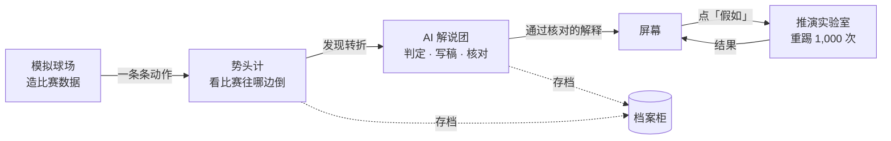

### 技术摘要

Pivot 是一个事件驱动的多 Agent 系统，做三件事：从合成比赛事件流中实时发现转折点，用可复算的证据解释它，再从转折点续跑模拟、回答“假如当时不是这样”。架构上的关键决策有六个：

1. **模块化单仓 + 端口与适配器**。领域核心不依赖任何云服务。同一份代码可以跑在三种部署形态上：本地 L、云端最小 C1、云端完整 C2。砍需求时只换形态，不动代码结构（[ADR-0001](adr/0001-modular-monorepo-ports-adapters.md)）。
2. **计算与生成分离**。模型写的每个数字都必须附带统计引用，由确定性的 Verifier 重算核对；不通过就打回重写，最多 2 次，之后降级为模板解释（[ADR-0005](adr/0005-stat-referenced-generation.md)）。
3. **显式工作流编排**。用 Microsoft Agent Framework 搭两条固定的链：发现链（Judge → Explainer ⇄ Verifier）和推演链（Translator → 执行器 → Comparator → Verifier）（[ADR-0004](adr/0004-agent-framework-workflows.md)）。
4. **事件骨干**。事件流走 Event Hubs，Agent 任务走 Service Bus，实时推送走 Web PubSub，存储用 Cosmos DB Serverless（[ADR-0002](adr/0002-event-hubs-match-event-stream.md)、[0003](adr/0003-service-bus-work-queues.md)、[0006](adr/0006-cosmos-db-serverless.md)、[0007](adr/0007-web-pubsub-realtime.md)）。
5. **可快照的控球链模拟器 + 公共随机数**。模拟器既负责生成比赛，也负责续跑推演，还能植入已知转折点作为评测的标准答案（[ADR-0008](adr/0008-possession-chain-simulator.md)）。
6. **一键部署**。azd + Bicep 创建全部资源，服务之间只用托管身份，仓库里没有任何密钥（[ADR-0013](adr/0013-platform-baseline-azd-bicep-identity.md)）。

## 1. Step 0：现状与架构驱动因素

### 1.1 现状

| 项 | 结论 |
|---|---|
| 代码 | 全新项目。仓库里只有两个 HTML 文档（选题板和 PRD），没有代码、依赖、基础设施或 CI；`main` 分支还没有任何提交 |
| 需求来源 | PRD v1.0：22 条功能需求、13 项非功能需求、5 个 Agent 的规格草案 |
| 团队 | 4 人。A 负责平台，B 负责模拟器，C 负责前端，D 负责 Agent |
| 时间 | 今天 10/23 下午开工，10/26 晚提交，10/27 只作缓冲。PRD 原计划从 10/21 开始，现在压缩到 3.5 天 |

**本文对 PRD 的修订**

- SignalR Service 改为 Web PubSub（ADR-0007）；
- 部署分成 L、C1、C2 三档（ADR-0001）；
- Verifier 改为确定性规则加统计引用（ADR-0005）；
- Cosmos DB 改为两个容器，并引入“分钟文档”（ADR-0006）；
- 任务级的分工和排期以《Pivot 开发手册》为准（`docs/plan/tasks.csv`）。势头与变点检测由 B 负责，D 用足球常识把关阈值。

### 1.2 质量属性优先级

| 优先级 | 质量属性 | 刺激 | 响应 | 度量 |
|---|---|---|---|---|
| 1 | 演示可靠性 | 录 Demo 时模型被限流 | 自动退避重试，然后降级为模板解释，界面不报错 | 120 秒脚本一次跑通 |
| 2 | 正确性与可解释性 | Explainer 写出错误数字 | Verifier 重算后拦截并打回 | 上屏数字错误为 0；每句至少 1 个证据 |
| 3 | 可修改性与并行开发 | 4 人同时开发 | 只依赖冻结的契约和端口的假实现 | 第一天结束时每个人都能独立运行自己的部分 |
| 4 | 实时性 | 60 倍速回放 | 指标推送，转折点上屏 | 指标 p95 ≤ 2 秒；转折点 p95 ≤ 10 秒 |
| 5 | 可扩展性 | 推演次数 N 从 500 增加到 5,000 | 切换到 AcaJobExecutor | 业务代码零改动 |
| 6 | 成本 | 开发 4 天，评审期约 4 周 | 优先 Serverless、免费层和缩容到 0 | 开发期 < $50，有预算告警 |
| 7 | 安全 | 公开仓库 + 公网 Demo | 托管身份、无密钥、限流 | 秘密扫描 0 告警 |

### 1.3 约束与假设

- **约束**：只能使用合成数据；不得使用英超标识、真实球队或真实球员；技术栈以微软为主（Foundry、Agent Framework、Azure）；GitHub 仓库必须公开；视频短于 2 分钟。
- **假设**：所选区域的 Foundry 有 standard 和 mini 两档模型可用，且配额足够；团队有权在订阅里创建资源；每人每天有效开发约 10 小时；评审主要看视频，同时可能访问公网 Demo，直到 11/20 公布结果。

> 以下第 2–5 节是 10/23 的原计划。实际上线的样子见文档开头的「实际上线的样子」。

## 2. C4 第 1 层：系统上下文

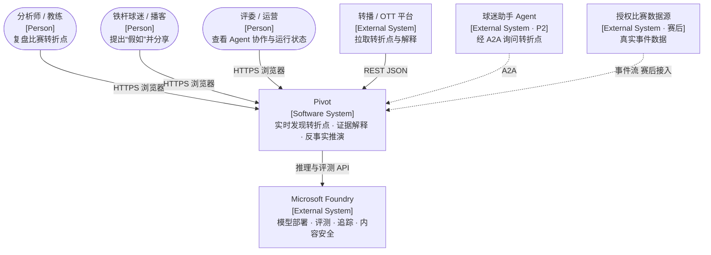

| 元素 | 类型 | 与 Pivot 的关系 | 本次范围 |
|---|---|---|---|
| 分析师 / 教练 | 人 | 主用户：看实时看板、读转折点解释、发起推演 | 是 |
| 铁杆球迷 / 播客 | 人 | 提出“假如”，查看结果分布 | 是 |
| 评委 / 运营 | 人 | 查看 Agent 轨迹和运行状态 | 是 |
| 转播 / OTT 平台 | 外部系统 | 通过只读 REST 接口拉取转折点 | 只读 API（Could） |
| Microsoft Foundry | 外部系统 | 模型推理、离线评测、追踪、内容安全 | 是 |
| 授权比赛数据源 | 外部系统 | 赛后接入真实事件，替换模拟器 | 否（端口已预留） |
| 球迷助手 Agent | 外部系统 | 通过 A2A 调用“解释转折点” | 否（P2） |

## 3. C4 第 2 层：容器

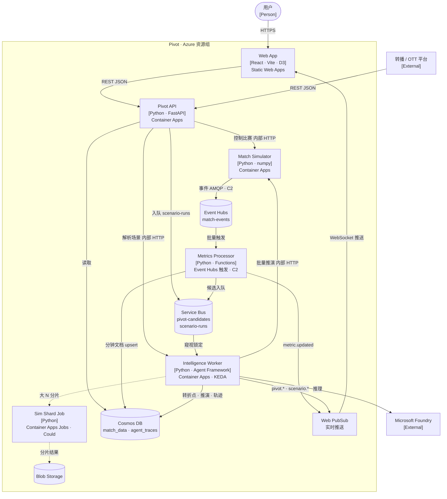

| 容器 | 职责 | 技术 | 负责人 | 入口 | 扩缩 |
|---|---|---|---|---|---|
| Web App | S0 到 S4 共五个页面；图表；实时订阅 | React 18 + TS + Vite + D3 | C | 公网 | 静态托管 |
| Pivot API | REST BFF；协商实时连接；限流；场景入队 | FastAPI | A | 公网 | 1–3 副本，按 HTTP 并发 |
| Match Simulator | 实时比赛运行器；批量推演；快照与恢复；C1 下还在进程内算指标 | Python + numpy | B | 仅内部 | 演示期最少 1 个副本 |
| Metrics Processor | 去重、写分钟文档、EWMA/CUSUM、候选入队、推送（C2） | Functions Flex Consumption | A | Event Hubs | 按分区扩缩；1 个常备实例 |
| Intelligence Worker | 发现链与推演链；轨迹；推送 | Agent Framework | D | 内部 + Service Bus | KEDA，1–5 个副本 |
| Sim Shard Job | N > 2,000 时分片推演（Could） | Container Apps Jobs | B / A | 无 | 按执行并行 |
| Event Hubs | 有序事件日志，分区键为 matchId（C2） | Standard 1 TU，2 个分区 | A | — | — |
| Service Bus | Agent 任务队列，含死信和重复检测 | Standard | A | — | — |
| Cosmos DB | 比赛数据与 Agent 轨迹 | NoSQL Serverless | A | — | — |
| Web PubSub | 按比赛分组推送 | 开发期免费层，评审期 Standard | A | — | — |

### 3.1 部署形态

| 形态 | 运行的容器 | 指标在哪里算 | 推演执行器 | 适用场景 | 状态 |
|---|---|---|---|---|---|
| L 本地 | 单进程（api、simulator、worker 同进程） | 进程内 | 本地进程池 | 开发、测试、最后兜底 | Must |
| C1 云端最小 | api、simulator、worker 三个 Container App；Service Bus；Cosmos；Web PubSub | 模拟器进程内（`InProcessEventSink`） | 本地进程池 | 公网 Demo | Must |
| C2 云端完整 | C1 加 Event Hubs 和 Functions | Functions（`EventHubsEventSink`） | 进程池 + Jobs | 冲 Cloud Native 奖 | Should / Could |

## 4. C4 第 3 层：组件

### 4.1 Intelligence Worker

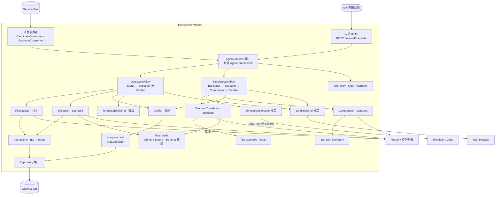

| 组件 | 职责 | 关键约定 |
|---|---|---|
| CandidateConsumer / ScenarioConsumer | 从 Service Bus 拉取消息，续期锁定，完成或放弃消息 | 幂等：消息 ID 即业务 ID，开始处理前先检查状态 |
| AgentRuntime 端口 | 屏蔽 Agent Framework 的 API 细节；创建工作流；注入工具和模型客户端 | 锁定 SDK 版本；所有模型调用都经过这里，便于统一重试和计量 |
| DetectWorkflow / SimulateWorkflow | 定义节点和边；把重写次数作为工作流状态 | 每次节点交接写一条 `AgentTrace` |
| PivotJudge | 判断候选点是否成立，并给出严重程度 | mini 模型，超时 4 秒 |
| Explainer / Comparator | 生成结构化解释，必须带统计引用和证据 | standard 模型，temperature 0.2，超时 8 秒 |
| Verifier | 确定性核查（见 §6.3） | 不调用模型；输出 `{pass, issues[]}` |
| TemplateExplainer | 降级时从关键事件和统计值拼出三句话 | 永不失败 |
| ScenarioTranslator | 把自然语言转成 `ScenarioSpec` | standard 模型；输入先过 Content Safety |
| Guardrails | 内容安全过滤；JSON Schema 校验；长度和禁用词检查 | 校验失败视同核查不通过 |
| SimulationExecutor 端口 | 运行批量推演 | `LocalPoolExecutor` 和 `AcaJobExecutor` 调用同一个 `run_shard` |

### 4.2 pivot_core（领域核心）

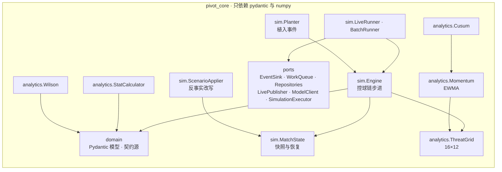

**依赖规则**：`pivot_core` 不得 import `pivot_adapters` 或 `apps/*`，由 CI 中的 import-linter 检查。

## 5. 运行时视图

### 5.1 实时发现与解释（C2 形态）

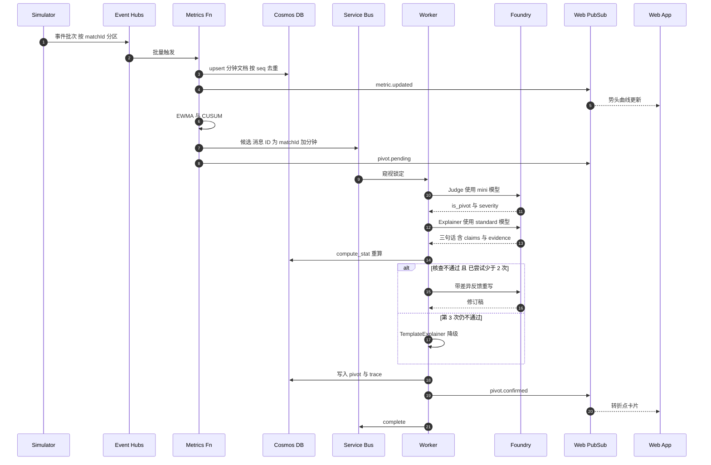

C1 形态下，第 1 到 6 步合并在模拟器进程内完成，从候选入队开始与上图相同。

### 5.2 What-if 推演

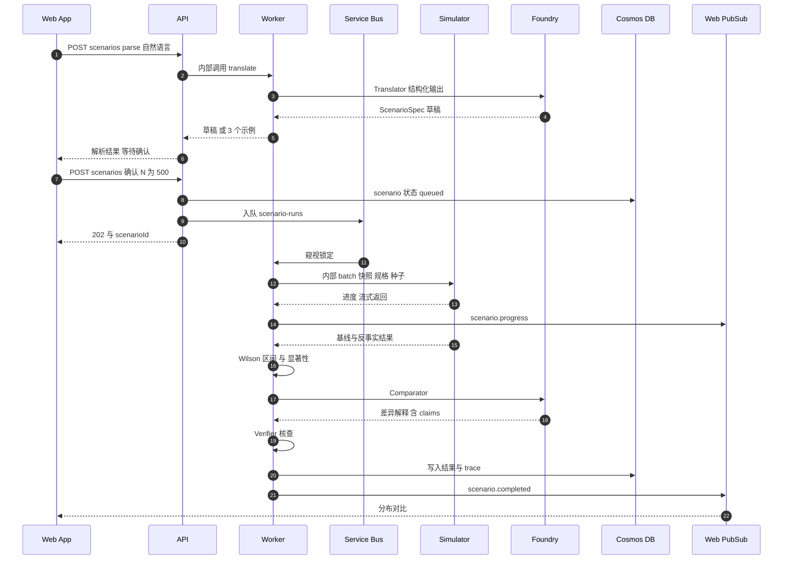

用户点击场景按钮（P0 的主路径）时，跳过第 1 到 6 步，直接由按钮生成 `ScenarioSpec`。

### 5.3 延迟预算

| 链路 | 环节 | 预算 | 依据 |
|---|---|---|---|
| 事件到界面（p95 ≤ 2 秒） | 模拟器批量发送 | 200 毫秒 | 每 200 毫秒发送一批 |
| | Event Hubs 到 Functions | 500 毫秒 | 设置触发批量的最大等待时间 |
| | 写分钟文档 | 50 毫秒 | 单分区写入 |
| | Web PubSub 推送到浏览器 | 300 毫秒 | 同区域 |
| | 余量 | 950 毫秒 | — |
| 候选到转折点上屏（p95 ≤ 10 秒） | 入队与拉取 | 300 毫秒 | — |
| | Judge（mini） | 1.5 秒 | 约 1.5k 输入 tokens |
| | Explainer（standard） | 4 秒 | 约 3k 输入、400 输出 tokens |
| | Verifier | 100 毫秒 | 确定性计算 |
| | 一次重写 | 3.5 秒 | 按约 30% 的概率触发 |
| | 写入与推送 | 300 毫秒 | — |
| 推演（p95 ≤ 30 秒） | 1,000 次续跑 | 3 到 6 秒 | 2 vCPU 进程池，估算值 |
| | Comparator 与核查 | 5 秒 | — |
| | 排队与推送 | 1 秒 | — |

## 6. Agent 设计

### 6.1 发现链工作流

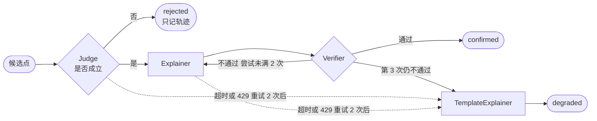

### 6.2 Agent 规格

| Agent | 模型档位 | 输入 | 输出（Pydantic） | 工具 | 超时 / 重试 | 降级 |
|---|---|---|---|---|---|---|
| PivotJudge | mini | 候选点、前后各 8 分钟的关键事件、指标 | `JudgeVerdict{is_pivot, severity, trigger_event_ids}` | get_events、get_metrics | 4 秒 / 2 次 | 只按算法结果标记，状态为 degraded |
| Explainer | standard | 转折点、事件窗口、指标对比、统计词表 | `headline` + `list[ExplanationSentence]`（1 到 3 句） | get_events、get_metrics | 8 秒 / 2 次 | TemplateExplainer |
| Verifier | 无（规则） | 解释草稿 | `Verdict{pass, issues[]}` | compute_stat | — | — |
| ScenarioTranslator | standard | 用户文本、当前比赛状态、场景目录 | `ScenarioSpec` 或 `ParseFailure{suggestions[3]}` | list_scenario_types | 6 秒 / 1 次 | 返回 3 个示例按钮 |
| Comparator | standard | 两组分布、关键统计差异 | `list[ExplanationSentence]` | get_sim_summary | 8 秒 / 2 次 | 模板：只陈述分布和区间 |

### 6.3 核查算法

```text
verify(draft, match, pivot):
  issues = []
  if not 1 <= len(draft) <= 3: issues += "句数越界"
  for s in draft:
    if words(s.text) > 30: issues += "超长"
    if not 1 <= len(s.evidence_ids) <= 4: issues += "证据数量越界"
    for eid in s.evidence_ids:
      e = repo.event(eid)
      if e is None or not (pivot.minute-8 <= e.minute <= pivot.minute+5): issues += f"证据 {eid} 无效"
    for c in s.claims:
      v = StatCalculator(match).compute(c.stat_ref)
      if not within_tolerance(c.value, v, c.unit): issues += f"{c.stat_ref} 写 {c.value}，实为 {v}"
    if has_direction_word(s.text) and direction_mismatch(s, StatCalculator): issues += "方向词不符"
    if has_significance_word(s.text) and not ci_non_overlap(...): issues += "显著性措辞不成立"
    if banned_terms(s.text): issues += "禁用词"
  return Verdict(pass=not issues, issues=issues)
```

容差：计数精确相等；百分比 ±0.5 个百分点；xG ±0.01；势头指数 ±0.02。通过后，上屏数字一律替换为计算值。

### 6.4 Prompt 与结构化输出约定

- 系统提示包含：角色、受众（见下文“受众和语言”）、统计词表、禁用词表、输出 JSON Schema、2 个 few-shot 示例（取自评测种子）。
- 模型输出一律使用结构化输出（JSON Schema 严格模式）；Pydantic 校验失败视同核查不通过。
- 所有 prompt 放在 `apps/worker/prompts/*.md` 里做版本管理，trace 中记录 prompt 的哈希。
- 受众和语言：系统提示按 `ViewerPrefs` 注入观看模式（analyst / fan）、主队、关注球员和语言（en / zh / es）。界面默认英文，面向国际评委。

## 7. 数据与契约

### 7.1 存储模型

| 容器 | 文档类型 | id | 主要字段 |
|---|---|---|---|
| `match_data` | match | `{matchId}` | seed、teams、status、speed、score、clock、`runtime{ewma, cusum_pos, cusum_neg, cooldown_until}`、`_etag` |
| | minute | `{matchId}:{minute}` | events[]、metrics{momentum, threat_home, threat_away, pressure_home, pressure_away}、snapshot（整分钟时刻的 MatchState） |
| | pivot | `{matchId}:p{minute}` | 见 `Pivot` 模型 |
| | scenario | `{matchId}:s{uuid}` | spec、status、progress、result |
| `agent_traces` | trace | `{chainId}:{step}` | agent、model、prompt_hash、input_ref、output 摘要、latency_ms、tokens、status；TTL 7 天 |

### 7.2 消息契约

**Event Hubs `match-events`**：每条消息是一个 `MatchEvent`（见 §7.4），应用属性包括 `matchId`、`seq` 和 `traceparent`。

**Service Bus**

| 队列 | 消息体 | 消息 ID |
|---|---|---|
| `pivot-candidates` | `PivotCandidate{match_id, minute, direction, cusum_stat, swing, key_event_ids[], window}` | `{matchId}:{minute}` |
| `scenario-runs` | `ScenarioRun{scenario_id, match_id, spec}` | `scenarioId` |

**Web PubSub 信封** `{type, match_id, seq, ts, payload}`

| type | 发布方 | payload |
|---|---|---|
| `match.status` | Simulator | status、minute、score、speed |
| `event.batch` | Simulator / Fn | events[]、seq 范围 |
| `metric.updated` | Simulator / Fn | minute、momentum、pressure_home、pressure_away |
| `pivot.pending` | Simulator / Fn | pivotId、minute、direction |
| `pivot.confirmed` / `pivot.degraded` | Worker | `Pivot` |
| `pivot.rejected` | Worker | pivotId |
| `scenario.progress` | Worker | scenarioId、done、total |
| `scenario.completed` | Worker | `SimResult` |
| `trace.appended` | Worker | `AgentTrace` 摘要 |

### 7.3 REST API

| 方法 | 路径 | 说明 | 限流 |
|---|---|---|---|
| POST | `/api/matches` | 创建比赛：seed、speed、teams，可选 plants；`preset=demo-1021` 直接使用演示预设 | 每 IP 每分钟 5 次 |
| GET | `/api/matches` | 最近的比赛 | — |
| GET | `/api/matches/{id}` | 比赛状态 | — |
| POST | `/api/matches/{id}/control` | start、pause、resume、speed、seek | 每 IP 每分钟 30 次 |
| GET | `/api/matches/{id}/timeline?from=&to=&sinceSeq=` | 分钟指标和事件，用于断线补齐 | — |
| GET | `/api/matches/{id}/pivots` | 转折点列表 | — |
| GET | `/api/matches/{id}/pivots/{pivotId}` | 转折点详情 | — |
| POST | `/api/matches/{id}/pivots/{pivotId}/feedback` | 标记“不是转折点”（Won't，接口先预留） | — |
| GET | `/api/matches/{id}/events/{eventId}` | 单个事件 | — |
| POST | `/api/matches/{id}/scenarios:parse` | 自然语言转成 ScenarioSpec 草稿 | 每 IP 每分钟 10 次 |
| POST | `/api/matches/{id}/scenarios` | 确认并运行，返回 202 | 每 IP 每分钟 10 次；全局每分钟 20,000 次模拟 |
| GET | `/api/matches/{id}/scenarios/{scenarioId}` | 进度与结果 | — |
| GET | `/api/matches/{id}/traces?chainId=` | Agent 轨迹 | — |
| GET | `/api/realtime/negotiate?matchId=` | Web PubSub 客户端连接 URL | — |
| GET | `/api/health` | 健康检查 | — |

FastAPI 会自动生成 OpenAPI 文档，地址是 `/api/docs`（对应 F17，几乎不额外花时间）。

### 7.4 领域模型（数据格式的唯一来源）

源文件在 [`packages/pivot_core/src/pivot_core/domain/`](../packages/pivot_core/src/pivot_core/domain/)，以代码为准。导出的 JSON Schema 在 `packages/contracts/schema/pivot.schema.json`，前端类型在 `packages/contracts/ts/pivot.ts`，两者都由脚本生成，不要手改。

| 文件 | 模型 |
|---|---|
| `match.py` | `Match`、`Team`、`Score` |
| `people.py` | `Player`、`PlayerAttributes`（七组 34 项）、`Personality`、`Coach`、`CareerStint`、`Relationship` |
| `lineup.py` | `TeamSheet`、`LineupSlot`、`TeamTactics`、`PlayerInstruction`、`Substitution` |
| `context.py` | `MatchContext`、`Competition`、`PreMatchCondition`、`OffFieldEvent`、`ContextEffect`、`TeamForm`、`HeadToHead` |
| `officials.py` | `Referee`、`FoulDetail`、`VarReview`、`InjuryInfo` |
| `events.py` | `MatchEvent`（`minute`、`from_zone`、`to_zone` 由 `t` 和坐标推出，会随 JSON 一起输出） |
| `tracking.py` | `TrackingFrame`、`PlayerPosition`、`BallPosition`（每秒一帧） |
| `stats.py` | 统计词表 `StatMetric`（23 项）、`STAT_UNITS`、`StatRef`、`Claim` |
| `narrative.py` | `ViewerPrefs`、`ExplanationSentence`、`Narrative` |
| `pivots.py` | `MinuteMetric`、`PivotCandidate`、`Pivot` |
| `scenarios.py` | `ScenarioSpec`、`PlantSpec`、`OutcomeDist`、`SimResult`、`Scenario` |
| `outputs.py` | `OverlayItem`、`OverlayFeed`、`PlayerMatchStats`、`Recap` |
| `traces.py` | `VerifierIssue`、`Verdict`、`AgentTrace` |
| `realtime.py` | 推送信封 `Envelope` |

**相对 v1.0 草稿的变化（10/23 B01）**

- **个性化**：新增 `ViewerPrefs{audience, language, focus_team, focus_player_id}`。AI 写的文字统一放进 `Narrative{prefs, headline, sentences, source, verifier_attempts, chain_id}`；`Pivot.narrative`、`SimResult.narrative`、`Recap.narrative` 存默认版本（analyst、en），其他版本按 `ViewerPrefs` 另外生成。原来 `Pivot` 上的 `headline`、`explanation`、`verifier_attempts` 挪进了 `Narrative`。
- **球员级统计**：`StatRef` 加了可选的 `player_id`，供关注球员模式使用。
- **传球接球人**：`MatchEvent` 加了可选的 `receiver_id`。
- **对齐真实事件数据**（参考 StatsBomb、Opta、SPADL）：事件改用连续坐标 `location` / `end_location`（105 × 68 米，主队始终向 x = 105 进攻），`from_zone` / `to_zone` 改为由坐标推出；新增 `shot_outcome`、`ball_speed_kmh`、`under_pressure`、`possession_id`、`play_pattern`；事件类型补上 dribble、save、duel、clearance、block、ball_recovery、offside、tactical_shift；进球不再是单独的事件类型，而是 `shot_outcome = "goal"` 的射门；`Team` 加了 `formation`。事件还记录 `success_prob`（模拟器给出的成功概率，即传球难度）、`pass_type`、`pass_height`、`body_part` 和 `related_event_ids`；`Player` 改用细分位置 `role`（`position` 由它推出），并加了 `preferred_foot` 和能力值 `PlayerAttributes`；`PlayerPosition` 加了 `fitness`。真实度规则和标定目标见 PRD 6.3。
- **能力值、阵容与场外因素**（[ADR-0015](adr/0015-match-context-and-off-field-factors.md)）：能力值扩到 34 项（七组），加汇总分、隐藏性格值、身体资料和特长标签；新增 `Coach`、`CareerStint`、`Relationship`、`TeamSheet`、`LineupSlot`、`TeamTactics`、`PlayerInstruction`、`Substitution`、`MatchContext`、`Competition`、`PreMatchCondition`、`OffFieldEvent`、`ContextEffect`。`Team` 去掉了 `formation` 和 `players`，改为 `squad`、`sheet`、`tactics`、`coach`、`club_id`；`Match` 加了 `context`；开场、阵型调整、换人事件带上阵容单和战术。解释句子加了 `context_ids`。
- **补时、加时和点球大战**：`t` 改为从开球起累计的秒数（含补时和加时，所以全场唯一、只增不减），事件加了 `period_t`（阶段内的秒数）和自动推出的 `clock_label`（63′、45+2′、PEN）；阶段编号沿用 StatsBomb，1、2 是上下半场，3、4 是加时，5 是点球大战。新增 `added_time` 事件和 `added_minutes`、`shootout_round` 字段；`Match` 加了 `periods`（各阶段起止和补时）和 `decided_by`，`Score` 加了点球大战比分；`Competition` 加了 `extra_time` 和 `penalty_shootout`；推演结果加了淘汰赛的晋级概率 `home_advance`。所有“分钟”都按累计时间计算（`t // 60`），界面显示用 `clock_label`。
- **裁判、伤病、门将和比赛细节**：新增虚构主裁 `Referee`（判罚尺度、出牌倾向、让有利倾向）；犯规和出牌带 `FoulDetail`（犯规类型、是否让有利、是否判点、牌和出牌原因）；新增 `var_review` 事件和 `VarReview`；`injury` 事件带 `InjuryInfo`（部位、严重程度、原因、能否坚持），赛前状态有伤停名单。`save` 事件改为 `goalkeeper` 事件，带 `keeper_action`（扑住、扑出、托出、失球、接高球、拳击、出击、封堵、捡球）和 `keeper_technique`；射门带门将站位 `keeper_location`。事件还加了 `duel_type`（空中 / 地面）、`counterpress`（丢球 5 秒内的反抢）和 `delivery`（内旋、外旋、直线）。战术加了定位球套路 `SetPieceTactics`；比赛背景加了 `form`（近况）、`head_to_head`（交手记录）和场地状况。新增输出 `PlayerMatchStats`（单场评分和个人数据）。统计词表加了推进传球、PPDA、xA、场地倾斜度，共 23 项。
- **数据定义**：每种事件什么时候产生、每个字段怎么判断，写在《数据定义说明》（`docs/data-definitions.md`，任务 B15），模拟器、统计员和核查员都按它实现。
- **网格加细**：威胁网格从 12 × 8 改为 16 × 12；事件自动推出所在三分之一、纵向通道、禁区，都从进攻方视角计算。
- **全员位置**（[ADR-0014](adr/0014-per-second-positional-simulator.md)）：新增 `TrackingFrame` / `PlayerPosition` / `BallPosition`，每秒一帧；推送消息新增 `tracking.frame`；统计词表新增 4 项阵型数据（防线高度、阵型宽度、压迫距离、跑动距离），共 19 项。
- **新输出**：`OverlayItem` / `OverlayFeed`（转播叠加层）和 `Recap`（终场报道）。
- **新增模型**：`Match`、`Team`、`Player`、`Scenario`、`PlantSpec`、`Verdict`、`AgentTrace`、`Envelope`，原来只在表格里提到，现在都有了正式定义。
- **字段命名统一用 snake_case**：推送信封里的 `matchId` 改成了 `match_id`。

改完模型后运行：

```bash
uv run scripts/export_contracts.py            # 重新生成 JSON Schema
pnpm --filter @pivot/contracts gen:types      # 重新生成前端类型
uv run pytest                                 # 包括检查 Schema 有没有过期
```

## 8. 可靠性与故障模式

| 故障 | 如何发现 | 如何处理 | 用户看到什么 |
|---|---|---|---|
| 模型超时或限流（429） | SDK 异常 | 指数退避重试 2 次，然后降级为模板 | 转折点卡片上显示 “Auto summary” 标记 |
| 核查连续不通过 | Verifier 返回不通过 | 重写 2 次后降级 | 同上；轨迹面板显示每次被拒的原因 |
| Worker 处理到一半崩溃 | 消息锁定过期 | Service Bus 重新投递；用确定性 ID 判断，已完成的步骤直接跳过 | 转折点上屏晚几秒 |
| 毒消息 | 投递次数超过上限 | 进入死信队列，App Insights 告警 | 卡片 60 秒后从“待确认”转为“降级” |
| Functions 批处理失败 | 运行时重试 | 从检查点重放；upsert 加 `seq` 去重 | 无感 |
| Web PubSub 断线 | 客户端 onclose | 指数退避重连，然后用 `sinceSeq` 补齐 | 顶栏短暂显示 “Reconnecting…” |
| 模拟器崩溃 | 健康探针失败 | Container Apps 自动重启；比赛从最后一个整分钟快照恢复 | 比赛状态显示 “Resumed at 63′” |
| Cosmos 限流（429） | SDK 重试 | 按分钟批量写入；SDK 内置重试 | 无感 |
| 推演请求过多 | API 计数器 | 返回 429 和 Retry-After；排队 | “Lab is busy, retry in 20s” |
| 用户输入被内容安全拦截 | Content Safety 判定 | 拒绝解析 | 提示改写，并给出 3 个示例 |
| 区域级故障 | — | 不在范围内，单区域部署 | 视频作为兜底 |

## 9. 安全与合规

| 方面 | 措施 |
|---|---|
| 身份 | 一个用户分配托管身份，按服务授予数据面角色（见 ADR-0013）；本地开发用 DefaultAzureCredential |
| 密钥 | 仓库中零密钥；GitHub 秘密扫描与推送保护；部署用 OIDC 联合凭据 |
| 网络 | 只有 API 和 Web 对公网开放；simulator 和 worker 只有内部入口；Cosmos 和 Service Bus 允许 Azure 服务访问（时间不够做私有终结点，作为已知限制写进文档） |
| 滥用防护 | 每 IP 限流；全局推演配额；请求体大小上限；CORS 白名单只放 Web 的域名 |
| 内容安全 | 用户输入和模型输出都经过 Foundry 内容安全；禁用词表（博彩、绝对化措辞） |
| 数据 | 只有合成数据；虚构球队和球员；不收集个人信息；没有账号体系 |
| 品牌与版权 | 不使用英超标识；视频不用版权音乐；界面文案不暗示官方合作 |
| 供应链 | 依赖锁定（uv.lock、pnpm-lock）；开启 Dependabot 安全更新 |

## 10. 可观测性

- **追踪**：所有 Python 服务都接入 OpenTelemetry（Azure Monitor 发行版）。`traceparent` 通过 Event Hubs 和 Service Bus 的应用属性在服务间传递；Agent 链的 `chain_id` 等于 trace id。Agent Framework 的 Agent 和工具调用 span 在 Foundry 追踪视图中可见。
- **业务指标（SLI）**

| SLI | 目标 | 采集方式 |
|---|---|---|
| `event_to_ui_ms` p95 | ≤ 2,000 | 前端用信封中的 `ts` 计算后上报 |
| `pivot_publish_ms` p95 | ≤ 10,000 | Worker 记录候选入队到 confirmed 的时长 |
| `scenario_ms` p95 | ≤ 30,000 | Worker |
| `verifier_first_pass_rate` | ≥ 0.7 | 轨迹统计 |
| `fallback_rate` | ≤ 10% | 轨迹统计 |
| `dlq_depth` | 0 | Service Bus 指标，配置告警 |

- **日志**：结构化 JSON，统一包含 `matchId`、`chainId`、`agent` 字段。

## 11. 部署视图

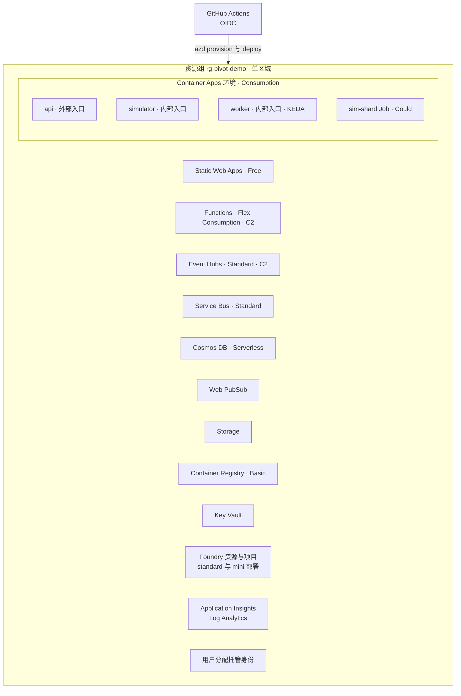

- **区域**：选 Foundry 所需的两档模型都可用、配额足够的区域，所有资源放在同一区域。
- **镜像**：一个 Python 镜像（`docker/python.Dockerfile`），通过 `command` 区分 api、simulator、worker 和 shard。
- **环境**：`pivot-dev`（开发，可随时重建）和 `pivot-demo`（评审期，10/26 冻结）。
- **成本护栏**：
  - 资源组预算告警设为 50 美元；
  - 录完视频后，把 worker 和 simulator 的最小副本数降到 0，取消 Functions 的常备实例；
  - 评审期如果不需要现场演示 C2，可以删除 Event Hubs 和 Functions，退回 C1，省下按小时计费的基础费用；
  - 11/20 公布结果后执行 `azd down --purge`。

## 12. 架构决策记录索引

| ADR | 决策 | 主要被否决的方案 |
|---|---|---|
| [0001](adr/0001-modular-monorepo-ports-adapters.md) | 模块化单仓 + 端口与适配器 + L/C1/C2 三档部署 | 微服务优先；单体脚本 |
| [0002](adr/0002-event-hubs-match-event-stream.md) | 事件流用 Event Hubs Standard | Service Bus 主题；HTTP 直连；Kafka |
| [0003](adr/0003-service-bus-work-queues.md) | Agent 任务用 Service Bus Standard 队列 | Storage 队列；Event Grid |
| [0004](adr/0004-agent-framework-workflows.md) | Agent Framework 显式工作流，循环有上限 | 单个大 prompt；自由对话式；LangGraph；Foundry 托管 Agent |
| [0005](adr/0005-stat-referenced-generation.md) | 统计引用 + 确定性核查 | LLM 评审；纯模板 |
| [0006](adr/0006-cosmos-db-serverless.md) | Cosmos DB Serverless + 分钟文档 | SQL / PostgreSQL；Table；Redis |
| [0007](adr/0007-web-pubsub-realtime.md) | Web PubSub 实时推送 | SignalR；SSE；轮询 |
| [0008](adr/0008-possession-chain-simulator.md) | 控球链模拟器 + 快照 + 公共随机数 | 物理模拟；LLM 生成事件；固定数据集 |
| [0009](adr/0009-pluggable-simulation-executor.md) | 推演执行器可插拔，默认本地进程池 | 一律用 Jobs；Durable Functions；Batch |
| [0010](adr/0010-change-point-detection.md) | EWMA + CUSUM 初筛 + LLM 判定 | 纯规则；纯 LLM；BOCPD |
| [0011](adr/0011-functions-stream-metrics.md) | Functions 计算流式指标 | Stream Analytics；Fabric 实时智能 |
| [0012](adr/0012-frontend-react-vite-d3.md) | React + Vite + D3，部署在 Static Web Apps | Next.js；Streamlit；Power BI |
| [0013](adr/0013-platform-baseline-azd-bicep-identity.md) | azd + Bicep、OIDC、托管身份 | Terraform；门户手工创建 |
| [0014](adr/0014-per-second-positional-simulator.md) | 模拟器每秒一步，生成全员位置，位置影响动作成功率（部分取代 0008） | 只有区域；事后补位置；25 帧物理模拟 |
| [0015](adr/0015-match-context-and-off-field-factors.md) | 阵容战术、生涯与场外因素进入模拟，影响小且必须可追溯 | 只看场上统计；场外因素只写进文案不进模拟 |

## 13. 实施指南

### 13.1 仓库结构

```text
pivot/
├── apps/
│   ├── api/                 # FastAPI BFF（A）
│   ├── simulator/           # 实时运行器、批量推演、内部 HTTP（B）
│   ├── worker/              # 工作流、Agent、prompts/（D）
│   ├── metrics-fn/          # Functions，Event Hubs 触发（A，C2）
│   └── web/                 # React + Vite + D3（C）
├── packages/
│   ├── pivot_core/          # domain · sim · analytics · ports（B 为主，A 负责 momentum 和 cusum）
│   ├── pivot_adapters/      # local/ 与 azure/（A；foundry 适配器由 D 负责）
│   └── contracts/           # 导出的 JSON Schema 和生成的 TS 类型
├── eval/                    # 种子、植入规格、检测评测、Foundry 评测配置（B、D）
├── infra/                   # main.bicep 与 modules/（A）
├── docker/python.Dockerfile
├── scripts/                 # dev.sh、export_contracts.py、seed_demo.py
├── docs/                    # architecture.md、adr/、product/、design/
├── .github/workflows/       # ci.yml、deploy.yml
├── azure.yaml
└── pyproject.toml           # uv 工作区
```

### 13.2 模块边界与依赖规则

1. `apps/*` 只依赖 `packages/*`；`pivot_core` 不依赖任何其他包（由 import-linter 检查）。
2. Azure 适配器只在每个应用的组合根（`apps/*/bootstrap.py`）里按 `PIVOT_PROFILE` 实例化。
3. 每个端口至少有两个实现：`local`（含测试用的假实现）和 `azure`，两者共用一组契约测试。
4. `apps/web` 只依赖 `packages/contracts` 生成的类型和 REST / WebSocket 接口。

### 13.3 契约优先流程

1. 修改 `pivot_core/domain` 中的模型 → 运行 `uv run scripts/export_contracts.py` 生成 JSON Schema → 运行 `pnpm --filter web gen:types` 生成前端类型。
2. **10/23 20:00 冻结契约**。冻结后只允许新增可选字段；其他任何变更都要在群里通知全员。
3. C 在冻结后立刻用 `eval/fixtures/demo-1021.json`（B 当晚产出）开发前端，不必等后端完成。

### 13.4 排期与关键路径

> 下图是里程碑视角的粗排。精确到任务的分工、依赖和验收标准见《Pivot 开发手册》，以它为准。

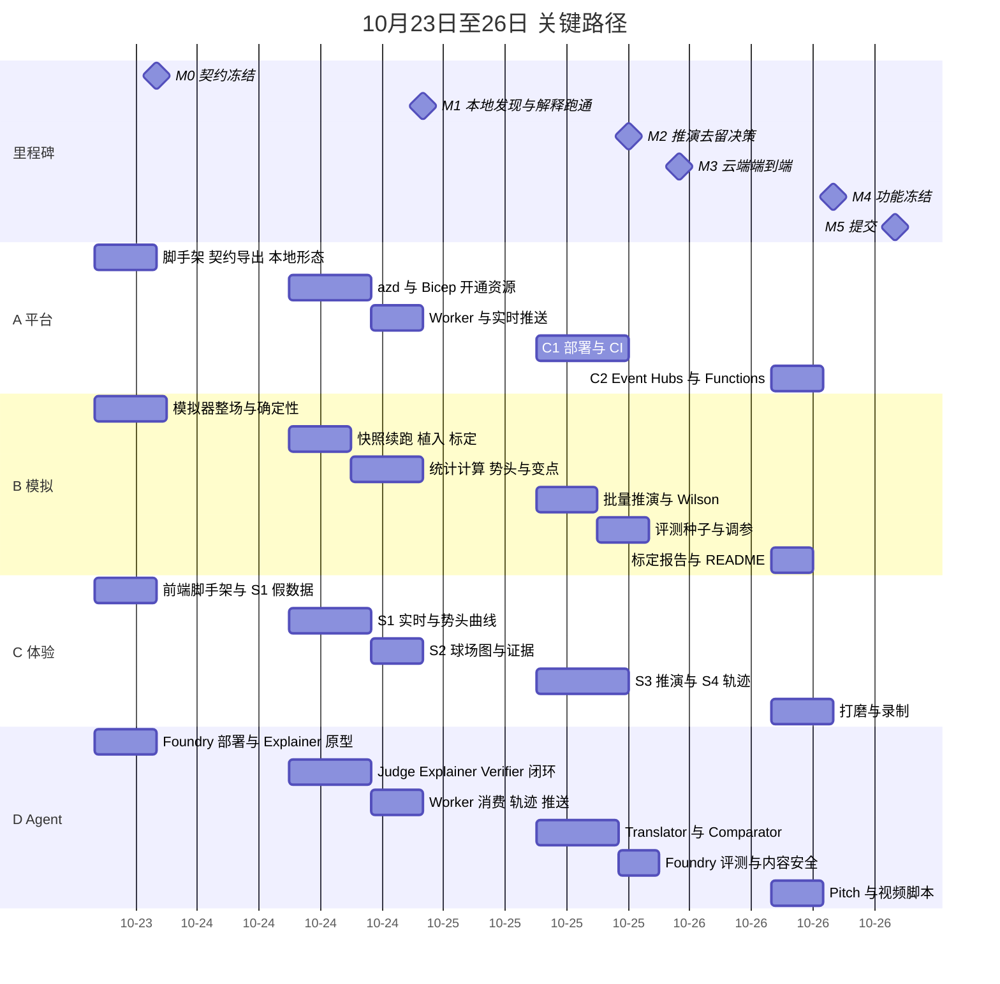

**关键路径**：B01 契约 → B03 模拟器 → B04 快照续跑 → B08 批量推演 → A09 推演接线 → C05 实验室页面 → M2。发现链这一支是 B05 统计 → B06 变点 → D06 工作流 → M1。

**落后时按以下顺序砍需求**（与 RICE 结果一致）：F14 评测 → F11 Event Hubs 与 Functions（退回 C1）→ F12 轨迹面板（改为展示 Foundry 追踪视图）→ F13 自然语言解析（只保留场景按钮）→ M2 时如果推演闭环还没跑通，整段推演移出 Demo。

### 13.5 完成定义（DoD）

- 符合冻结的契约，Schema 校验通过；
- 确定性逻辑（模拟器、指标、核查）都有单元测试；
- 在本地形态 L 下能跑通，在 C1 部署后冒烟测试通过；
- 对应的 Demo 脚本步骤能现场演示；
- 轨迹和遥测里能看到这项功能的记录。

## 14. 技术风险与待定问题

| 风险或问题 | 影响 | 应对 | 负责人 |
|---|---|---|---|
| 所选区域的 Foundry 模型配额（TPM）不足 | Agent 延迟和限流 | 今天就创建部署，测试并发；mini 模型分担 Judge | D |
| Agent Framework SDK 接口变动 | 编译失败或行为变化 | 锁定版本；用 `AgentRuntime` 端口隔离 | D |
| 所选区域不支持 Functions Flex Consumption | C2 受阻 | 退回 C1；或改用 Consumption 计划 | A |
| 评审期多人同时访问，超出 Web PubSub 免费层 | 实时连接失败 | 10/26 升级为 Standard 1 单位 | A |
| 模拟器统计特性不像真实比赛 | 推演可信度受质疑 | 公开标定统计和局限 | B |
| 评审期约 4 周的云成本 | 预算超支 | 缩容到 0；退回 C1；设预算告警 | A |
| 提交截止时间的时区 | 错过截止 | 按 10/26 20:00（美东）提交，比截止早一天 | 全员 |
| Challenge 页是否提供官方数据 schema | 模拟器格式可能要兼容 | 今天确认；需要时加一个 `FeedAdapter` | B |
